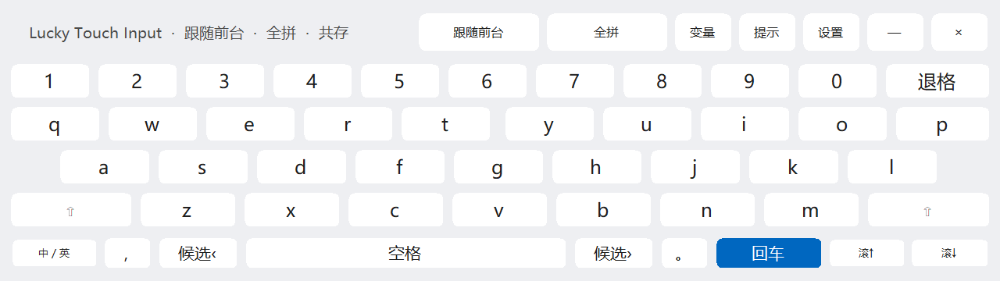
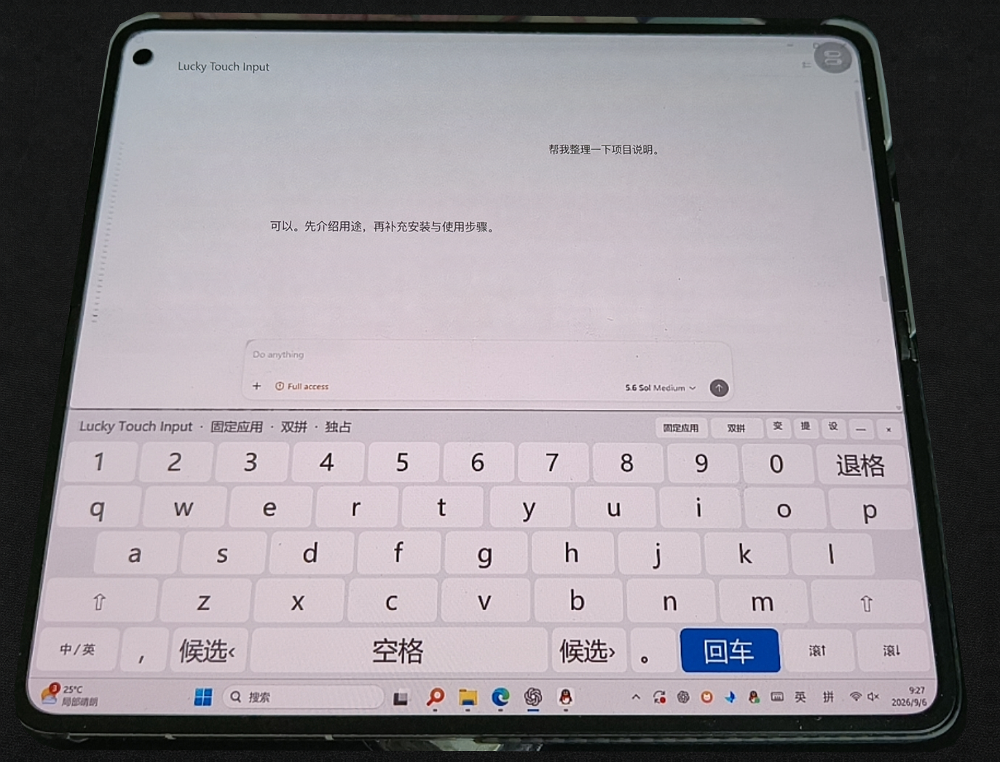
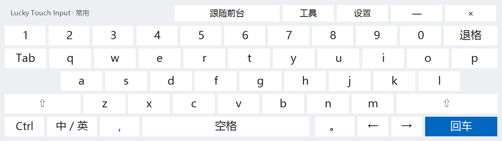
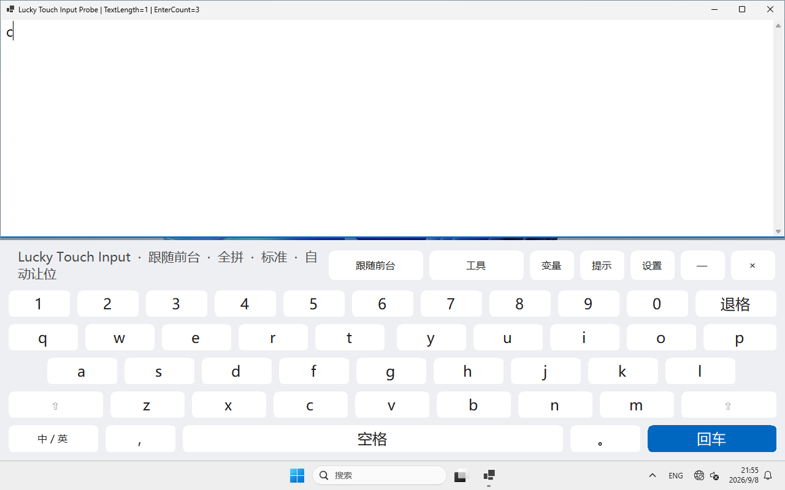

# Lucky Touch Input

Adaptive on-screen keyboard and input panel for Windows tablets and remote sessions.

> Alpha software. Lucky Touch Input does not create a remote connection and is not an input method.
> It runs on the Windows host, through a remote desktop or directly on a Windows touchscreen.
> No particular remote client is required; compatibility is not a client certification.

[简体中文](README.zh-CN.md)

`0.1.0-alpha.1` adds Standard / Phone large keys / Everyday layouts and revised
Windows-keyboard handoff. Everyday adds Tab, one-shot Ctrl, cursor keys, and an editing panel;
Phone large keys keeps the simpler bottom row. This prerelease passes 350 automated checks and
59 interactive checks in an offline Windows 11 VM. Validation limits are described below.

[Download Windows x64](https://github.com/fofc12/LuckyTouchInput/releases/tag/v0.1.0-alpha.1) ·
[Report a problem](https://github.com/fofc12/LuckyTouchInput/issues)



## Why

Phone and tablet remote-control clients often make the Windows touch keyboard hard to summon,
cover the active editor, or move the desktop unpredictably. Windows tablets can have the same
problem when the standard keyboard is too dense. Lucky Touch Input provides large, persistent keys
and a predictable window-avoidance layer on the Windows host.

## 0.1 alpha features

- No-activation, always-on-top touch panel: tapping a key does not intentionally steal editor focus.
- Follow-foreground, pinned-application, and floating modes.
- Responsive geometry for phones, tablets, foldables, DPI scaling, and multiple monitors.
- Standard QWERTY rows, persistent numbers, Shift, Backspace, Enter, candidate paging, and scrolling.
- Volatile session snippets and visible prompt insertion; neither submits text automatically.
- Optional Microsoft Pinyin full/double-pinyin switch.
- Optional Windows touch-keyboard suppression with recovery after an abnormal exit.
- Per-user startup toggle and a tray-menu recovery path.
- No network, telemetry, account, updater, or third-party NuGet dependency beyond .NET/WinForms.

## Requirements

- Windows 11 x64
- .NET 10 Desktop Runtime when using a framework-dependent build
- No administrator privileges

The ZIP is self-contained: extract and run, with no separate .NET installation. The initial release
is unsigned. Verify the source and SHA-256 if Windows flags it; do not disable security protection.
ARM64 packages are not provided yet.

## Quick start

1. Extract the portable x64 package and run `LuckyTouchInput.exe`.
2. Focus the editor or text field you want to type into. The panel follows that foreground window
   and leaves a small seam above itself.
3. Use the mode button to cycle through **Follow foreground**, **Pinned application**, and
   **Floating**. Open **Settings** to adjust height, left seam, Enter behaviour, startup, and
   coexistence with the Windows touch keyboard.
4. Tap `—` twice within two seconds to collapse safely. Double-click the tray icon, or use its
   **Show keyboard** menu item, to restore the panel. Use `×` or the tray menu to exit.
   Starting the EXE again restores the existing instance instead of adding another keyboard.

Start with **Follow foreground**, Enter set to stay open, and the default **Yield** policy.
The first alpha called its native policy coexist/suppress; alpha.1 uses yield/mutual exclusion.

## In use: a foldable, UU Super Screen, and Codex

With the foldable unfolded, NetEase UU streams the Windows desktop: Codex occupies the upper
area, Lucky Touch Input runs below it on the Windows host, and the taskbar remains beneath the
keyboard. UU handles the connection and desktop image; Lucky Touch Input handles host-side keys
and window avoidance. No Codex plugin is needed.



Based on an author-supplied early-alpha photo, cropped and lightly denoised with background cleanup.
The private title and conversation were replaced with AI-generated example content. The keyboard,
Start button, model selector, and clock retain the original photo. This is not an unmodified chat
screenshot, the new phone large-key layout, or a latency/compatibility benchmark.
See the [foldable setup guide](docs/FOLDABLE-UU.md) for setup, international-client scope, and image provenance.

## Build and run

Install the .NET 10 SDK, then:

```powershell
dotnet build LuckyTouchInput.sln -c Release
dotnet run --project tests/LuckyTouchInput.Tests -c Release
dotnet run --project src/LuckyTouchInput/LuckyTouchInput.csproj -c Release
```

In a disposable interactive Windows account or VM with no existing keyboard profile,
`pwsh -File tests/Invoke-UiAcceptance.ps1` checks actual text, modes, Enter policies, settings,
scrolling, single-instance recovery, and registry round trips. It refuses existing settings.
Do not run the full UI acceptance on your everyday work desktop.

Create a portable x64 build:

```powershell
pwsh -File scripts/Publish.ps1
```

## Modes

- **Follow foreground**: target and resize the current ordinary foreground window.
- **Pinned application**: keep targeting the process that was active when the mode was selected.
- **Floating**: keep the keyboard visible without resizing the target.

Settings are written to `%LOCALAPPDATA%\Lucky\TouchInput\settings.ini`. Enter keeps the keyboard
open by default. Windows touch-keyboard suppression is off by default.

## Everyday layout and Windows-keyboard handoff

Cycle **Settings → Layout** (`设置 → 布局`) through:

| Preset | Intended use and initial height |
| --- | --- |
| Standard | Existing controls; 42% in follow/pinned, 34% in floating mode |
| Phone large keys | Five-button bottom row and wide, rightmost Enter; 48% (floating cap: 44%) |
| Everyday | Desktop-style staggered rows, Tab, Ctrl, left/right arrows; 44% |

Height stays adjustable; selecting a preset applies its default height. Legacy `LargeKeys` settings
migrate without forcing existing users into a new layout. These presets do not change Windows DPI
or resolution: a host streaming 4K cannot infer the phone's physical dimensions.



This is a control-layout rendering, not a phone photo or proof of successful input. Ctrl and Shift
are one-shot: select a modifier, then a key, or tap the modifier again to cancel. Examples include
Ctrl+A, Shift+Tab, and Shift+arrow. **Tools → Edit** (`工具 → 编辑`) adds select-all, copy, paste, cut,
undo, redo, Home/End, and up/down arrows. Tools also retains scrolling and candidate paging.
The collapse-on-Enter setting affects bare Enter only, not Shift/Ctrl+Enter.

Change the native keyboard policy from Settings or the tray menu:

| Situation | Behavior |
| --- | --- |
| Yield (`让位`, default) | Hide Lucky and restore the target while a Windows keyboard is detected on its monitor; do not change Windows keyboard preferences |
| Mutual exclusion (`互斥`, experimental) | Temporarily suppress the touch keyboard only while Lucky is expanded with a valid target; release on collapse, target loss, or exit |
| Accessibility On-Screen Keyboard / OSK | Always yield; never close OSK, change its startup, or stop Windows input services |

Lucky resumes when the Windows keyboard disappears and the target is valid. Failed takeover waits
for native dismissal instead of repeatedly fighting the same pane; tray/EXE reopening permits an
explicit retry. Lease restoration preserves detected external preference changes; a forced kill
leaves a lease for next-launch recovery.

Modern touch panes require both window and input-pane geometry confirmation. A `TextInputHost`
process alone is not enough to hide candidates, emoji, or voice UI. Automatic exclusion may be
unavailable when Windows does not report a valid pane location. Use Windows touch-keyboard settings
or yielding in that case, not service shutdown. See Microsoft's explanation of the separate
[accessibility OSK](https://support.microsoft.com/en-us/accessibility/windows/use-the-on-screen-keyboard-osk-to-type).
UAC, elevated input, and transient flashes over a real UU connection still require explicit testing.

## Update, migrate, remove

- Exit before extracting an update into the same directory. Settings survive. If the directory
  changes, toggle startup off and on again to update the registered path.
- On first run, existing `LuckyTouchKeyboard` prototype settings are imported only if the new profile
  does not exist. Heights, Enter policy, and suppression choice are kept; the original is not modified.
  Codex maps to pinned application, Remote to follow foreground, and Desktop to floating.
- Exit the prototype and disable its login entry before upgrading. The app does not terminate other
  keyboards or rewrite their launch scripts.
- To remove: turn startup off, exit, and delete the extracted folder. Optionally remove the settings
  directory above. After a forced exit during suppression, restart once and exit normally first.

## Troubleshooting

- Missing numbers: settings/snippets/prompts temporarily use the number row. Tap the active button,
  now labeled `数字`, to bring it back.
- Candidate paging: the buttons send Page Up / Page Down; the IME determines whether these page candidates.
- Native keyboard appearing: experimental suppression handles the touch keyboard, not the separate
  accessibility On-Screen Keyboard (`osk.exe`). It never disables Windows input services or kills OSK.
  Lucky yields to detected OSK. After target loss it releases suppression and remains in
  the tray without occupying the screen.
- Unsuitable window resizing: use Floating for apps with restrictive minimum sizes, games, or dialogs.
- Microsoft Pinyin: the shortcut refuses to overwrite an existing custom double-pinyin mapping.

## Important boundaries

- The active Windows IME owns text composition and candidates. Candidate buttons emit Page Up and
  Page Down, which can be remapped by an IME.
- `SendInput` is restricted by Windows integrity levels. Elevated targets and the UAC secure desktop
  are unsupported.
- Native keyboard suppression uses Windows per-user input settings and an input-pane observer. It is
  marked experimental and should be enabled only when the standard keyboard conflicts with the app.
- The initial UI is Chinese. English UI resources are planned after the interaction model stabilizes.

See [architecture](docs/ARCHITECTURE.md), [privacy](docs/PRIVACY.md),
[security](SECURITY.md), [runtime notices](docs/THIRD-PARTY.md), and [contributing](CONTRIBUTING.md).

## Project status

`0.1.0-alpha.1` passes 350 settings/layout/ownership checks and 59 offline Windows 11 interactive
checks: committed text, modifiers, settings and modes, Enter, scrolling, single-instance recovery,
minimization, OSK handoff in both policies, and native-settings crash recovery.
At 1280×752 working area, the visible seam is 3 px and the taskbar is unobstructed.
See the [measured validation scope](docs/VALIDATION.md), including what has **not** been tested.



Real touch hardware, foldables, and remote-client combinations still need feedback. Passing a VM
check is not proof of compatibility with every device.

## License

[MIT](LICENSE)

<details>
<summary>Author and support</summary>

Author: free2ing (零西) · haoyunmail@qq.com


</details>
