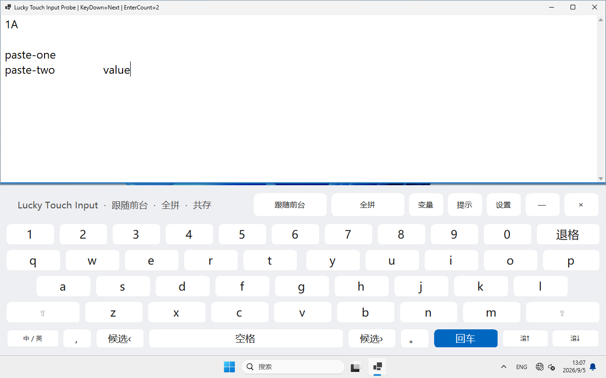

# Lucky Touch Input

面向 Windows 平板与远控场景的自适应触控输入面板。

> 当前为 Alpha。Lucky Touch Input 不负责建立远程连接，也不是输入法；它运行在 Windows
> 主机侧。可在远控客户端传回的桌面上操作，也可以在 Windows 触屏上直接用；不要求特定客户端。

[English](README.md)

[下载 Windows x64 便携版](https://github.com/fofc12/LuckyTouchInput/releases/tag/v0.1.0-alpha) ·
[反馈问题](https://github.com/fofc12/LuckyTouchInput/issues)


## 解决什么问题

用手机或平板远控 Windows 时，客户端键盘经常难以唤醒、遮住输入框，或者让桌面突然上移。
Windows 平板直接使用时，系统键盘也可能过于密集。Lucky Touch Input 在主机侧提供大按键、
稳定常驻和可预测的窗口避让。

## 0.1 Alpha 功能

- 无焦点激活的置顶触控面板，点按按键时尽量保留编辑器光标。
- 跟随前台、固定应用、自由悬浮三种模式。
- 适配手机、平板、折叠屏、DPI 缩放和多显示器。
- 标准 QWERTY、常驻数字行、Shift、退格、回车、候选翻页和滚轮。
- 退出即清空的会话片段，以及只插入、不自动提交的提示词快捷入口。
- 可选的微软拼音全拼/小鹤双拼切换。
- 可选的 Windows 原生触摸键盘抑制，并带异常退出恢复租约。
- 当前用户登录启动开关和系统托盘恢复入口。
- 不联网、无遥测、无账号、无自动更新；除 .NET/WinForms 外没有第三方 NuGet 依赖。

## 运行要求

- Windows 11 x64
- 使用依赖框架版本时需要 .NET 10 Desktop Runtime
- 不需要管理员权限

下载 ZIP 解压即可运行，已经包含 .NET 运行时，无需另行安装。首版未做代码签名；如 Windows
拦截，请先核对下载来源与 SHA-256，不要关闭系统安全防护。暂不提供 ARM64 包。

## 快速开始

1. 解压 Windows x64 便携包，运行 `LuckyTouchInput.exe`。
2. 先点一下要输入的编辑器或文本框；面板会跟随该前台窗口，并在两者之间保留很小的缝隙。
3. 点击模式按钮可在**跟随前台**、**固定应用**、**自由悬浮**之间切换；点击**设置**可调整高度、
   左侧缝隙、回车行为、登录启动，以及是否与 Windows 原生触摸键盘共存。
4. 两秒内连续点击两次 `—` 可以防误触地收起；双击托盘图标或选择“显示键盘”即可恢复。
   点击 `×` 或托盘菜单中的“退出”可以完整退出。
   再运行一次 EXE 也会恢复已有键盘，不会叠加第二个实例。

远控场景建议先使用“跟随前台 + 回车常驻 + 系统键盘共存”。只有 Windows 原生键盘反复覆盖
远控画面时，再在设置里启用实验性的“系统键盘：抑制”。

## 使用场景：折叠屏 + UU 超级屏 + Codex

折叠屏展开后，通过网易 UU 远程查看 Windows 桌面：上方留给 Codex 阅读和编辑，
下方使用运行在 Windows 上的 Lucky Touch Input，任务栏保留在键盘下面。
UU 负责连接与桌面画面，Lucky Touch Input 负责主机侧按键与窗口避让，不需要 Codex 插件。


基于作者提供的早期 Alpha 实拍，经过裁剪、轻度去噪和背景整理；私人标题与聊天区用 AI
替换成示例内容，键盘、开始按钮、模型选择与时间等保留原图。它不是未经修改的会话截图，
也不是新版手机大键布局截图或延迟、全客户端兼容性验收。
设置方式、国际版边界与图片处理说明见[折叠屏场景指南](docs/FOLDABLE-UU.md)。

## 构建与运行

安装 .NET 10 SDK 后执行：

```powershell
dotnet build LuckyTouchInput.sln -c Release
dotnet run --project tests/LuckyTouchInput.Tests -c Release
dotnet run --project src/LuckyTouchInput/LuckyTouchInput.csproj -c Release
```

在没有旧键盘配置的临时 Windows 用户或测试虚拟机中执行
`pwsh -File tests/Invoke-UiAcceptance.ps1`，验证实际输入、模式切换、回车策略、设置、滚轮、
重复启动恢复和系统设置往返。脚本拒绝覆盖现有用户配置；不要在日常工作桌面上运行完整验收。

生成带 SHA-256 校验文件的自包含 x64 便携包：

```powershell
pwsh -File scripts/Publish.ps1
```

## 三种模式

- **跟随前台**：跟随并避让当前普通前台窗口。
- **固定应用**：固定到切换模式时选中的进程。
- **自由悬浮**：保持输入面板，不调整目标窗口。

设置保存在 `%LOCALAPPDATA%\Lucky\TouchInput\settings.ini`。默认回车后保持键盘，默认与
Windows 原生触摸键盘共存。

## 更新与移除

- 更新：先退出键盘，再把新 ZIP 解压到原目录。设置保留；换目录后请重新开关一次“启动”。
- 从“零西触键”试用版迁移：首次启动、且新配置尚不存在时，会读取旧 `LuckyTouchKeyboard`
  配置，保留高度、常驻和抑制选项；旧文件不改动。旧 Codex 模式映射为固定应用，UU 模式映射为跟随前台。
- 升级前先退出旧版并关闭其登录入口，避免两套程序同时管理窗口。本程序不会自动停止第三方键盘或改写其启动脚本。
- 移除：关闭“启动”，退出程序后删除解压目录。需要清除偏好时，再删除上述用户配置目录。
  若曾强制结束抑制中的程序，请先重新启动一次，再正常退出，以恢复原生键盘设置。

## 常见问题

- 数字不见了：设置、变量、提示面板暂时借用数字行，点亮的按钮会改名为“数字”，点它返回。
- 候选翻页不生效：本程序发送 Page Up / Page Down，具体行为由输入法负责；没有自建候选框。
- 系统键盘突然出现：先区分触摸键盘与辅助功能的“屏幕键盘”（`osk.exe`）。实验抑制只处理前者，
  不会关闭 Windows 输入服务或强制结束 OSK。目标应用关闭后，本程序仍独立运行。
- 窗口不适合被调整：选择“自由悬浮”。窗口最小尺寸、游戏、特殊弹窗和高权限窗口可能限制避让效果。
- 双拼：微软拼音快捷开关不会覆盖已有的自定义方案；已有其他方案时，请在 Windows 拼音设置中选择。

## 重要边界

- 文字组合、词库和候选由当前 Windows 输入法负责。本程序的候选按钮只发送 Page Up / Page Down。
- Windows 完整性级别会限制 `SendInput`，不支持向高权限窗口或 UAC 安全桌面输入。
- 原生键盘抑制会临时修改当前用户的输入设置，因此属于实验选项；程序会保存原值，并在退出或
  下次启动发现异常租约时恢复。它不是系统级禁用；极短闪现仍需要按 Windows 版本与远控客户端实测。
- 首个 Alpha 的界面以中文为主；交互稳定后再补完整英文资源。

更多信息参见[架构](docs/ARCHITECTURE.md)、[隐私](docs/PRIVACY.md)、
[安全说明](SECURITY.md)和[贡献指南](CONTRIBUTING.md)。

## 当前状态

`0.1.0-alpha` 是首个公开预览版。58 项配置/布局检查与 34 项离线干净 Win11 交互检查通过，
覆盖实际文字、焦点、设置与模式、回车、滚轮、重复启动、最小化及崩溃后的系统设置恢复。
1280×752 工作区下，55 个按钮可用，可见窗口间隙 3 px，任务栏无重叠。
具体结果与尚未验证的范围见[验收说明](docs/VALIDATION.md)。



不同手机、折叠屏和远控客户端的真实触摸体验仍需反馈；虚拟机通过不代表所有设备已经验证。

## 许可证

[MIT](LICENSE)

<details>
<summary>作者与支持</summary>

作者：free2ing（零西） · haoyunmail@qq.com


</details>
